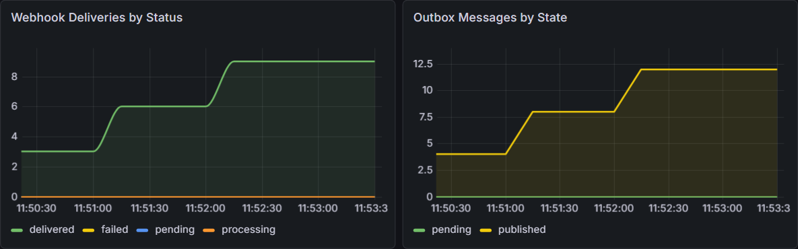
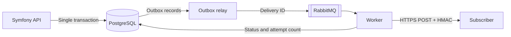
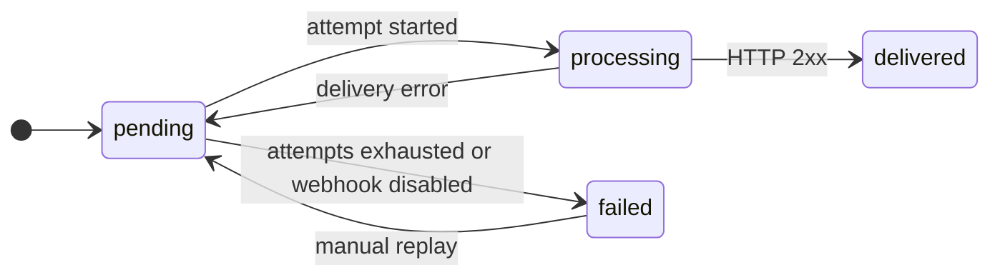
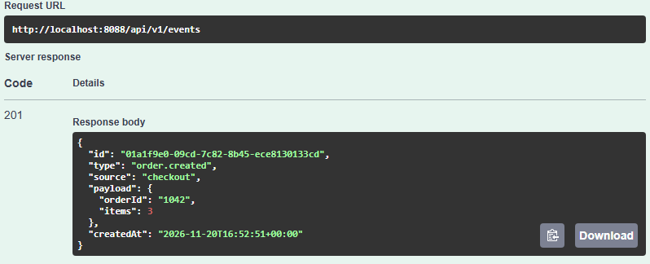

# EventFlow API

[](https://github.com/zhbforum/eventflow-api/actions/workflows/ci.yml?query=branch%3Amain)
[](openapi/openapi.yaml)
[](LICENSE)

EventFlow accepts events over HTTP and delivers them to subscribers via webhooks. An order service can publish `order.created` once and let the warehouse and billing services receive it independently. The publisher gets an event ID as soon as the transaction commits. Use it to look up each subscriber's delivery status, attempt count, and last error.

[Quick Start](#quick-start) · [Local HTTPS Demo](#local-https-demo) · [Your First Event](#your-first-event) · [Architecture](#architecture) · [Tests and CI](#tests-and-ci) · [Operations](#operations)

## Key Features

- **Recover a missed notification.** The transactional outbox keeps delivery jobs in PostgreSQL during a broker outage. Failed deliveries can be replayed individually.
- **Handle duplicates.** An idempotency key protects event creation. A stable delivery ID lets each subscriber recognize a retried webhook.
- **Verify the sender and destination.** Each outgoing HTTPS request carries an HMAC-SHA256 signature. The worker blocks private network destinations and disables redirects to protect against server-side request forgery (SSRF).
- **Keep organizations separate.** Events, subscriptions, and deliveries belong to an organization. Browser users sign in through OpenID Connect, with access governed by global roles and organization membership.
- **See where work is waiting.** Grafana shows pending deliveries, RabbitMQ queue depth, and the age of the oldest unpublished outbox entry.
- **Deploy and scale on Kubernetes.** A Helm chart deploys the API, worker, and outbox relay to a self-hosted k3d cluster. Argo CD manages GitOps synchronization, while KEDA scales workers based on RabbitMQ queue depth.



Across three runs of the HTTPS demo, nine deliveries reached `delivered`. Each manual replay added one outbox entry, bringing the published total to twelve.

## Tech Stack


Symfony Messenger handles queue processing. Keycloak provides browser-based authentication through OpenID Connect, while Prometheus and Grafana provide monitoring. In the production image, HTTP requests are served by FrankenPHP.

## Architecture



**Publishing.** The API finds active subscriptions for the event type within the publisher's organization. A single transaction saves the event and, for each matching subscription, a delivery record and an entry in the `outbox_messages` table. If RabbitMQ is temporarily unavailable, the job remains in PostgreSQL. A separate process (the outbox relay) selects records using `FOR UPDATE SKIP LOCKED` and marks them as published after receiving confirmation from the broker. [Event publishing](src/Service/EventPublisher.php) · [RabbitMQ publishing](src/Service/OutboxPublisher.php)

**Idempotent publishing.** For a given client and organization, concurrent publications with the same `Idempotency-Key` acquire the same PostgreSQL transaction-level advisory lock. The publisher compares the request fingerprint to the stored one. A match returns the existing event, and a different payload returns `409 Conflict`. [Event publisher](src/Service/EventPublisher.php) · [Request fingerprint](src/Service/EventRequestFingerprint.php)

**At-least-once delivery.** The worker signs requests using HMAC-SHA256. An HTTP `2xx` response marks the delivery as successful. If a subscriber processes the request but the response is lost, the webhook may be sent again. The subscriber can identify duplicate requests using the stable `X-EventFlow-Delivery-Id` header. [Delivery handler](src/MessageHandler/DeliverWebhookHandler.php) · [Signature format](src/Service/WebhookSigner.php)



Once the issue has been resolved, you can call `POST /api/v1/deliveries/{id}/replay` for a delivery in the `failed` state whose subscription is still active. The API responds with `202 Accepted` and records who initiated the replay along with the previous error. The worker checks the delivery generation number and skips messages from earlier attempts. [Replay implementation](src/Service/DeliveryReplayService.php)

## Quick Start

This setup is for local development. You need Git and Docker with the `docker compose` command. The application image includes PHP and Composer. A local Bearer token gives you access to the `legacy` organization's events, subscriptions, and deliveries. Browser sign-in and organization management use the optional [Keycloak setup](docs/local-oidc.md).

```sh
git clone https://github.com/zhbforum/eventflow-api.git
cd eventflow-api
docker compose up -d --wait db rabbitmq
docker compose run --rm --build app composer install
docker compose run --rm app php bin/console doctrine:migrations:migrate --no-interaction
```

Generate a local token for your first request. Copy the `MANAGEMENT_API_TOKEN=…` line from the output into a `.env.local` file in the project root.

```sh
docker compose run --rm --no-deps app php -r "echo 'MANAGEMENT_API_TOKEN=', bin2hex(random_bytes(32)), PHP_EOL;"
```

Start the API, worker, outbox relay, and Swagger UI.

```sh
docker compose -f compose.yml -f compose.workers.yml -f compose.docs.yml up -d --build --wait
```

| URL | What to check |
| --- | --- |
| [Swagger UI](http://localhost:8088/) | Interactive API documentation. The **Try it out** button sends requests to the local API. |
| [API readiness](http://localhost:8000/health/ready) | Returns `{"status":"ready","checks":{"database":"up"}}` when PostgreSQL is reachable. |
| [RabbitMQ Management](http://localhost:15672/) | Queues and consumers. Credentials for the local Compose setup are defined in [compose.yml](compose.yml). |

To stop the local environment, run `docker compose -f compose.yml -f compose.workers.yml -f compose.docs.yml stop`.

## Local HTTPS Demo

After the Quick Start, run a signed delivery from the outbox through RabbitMQ to the project's HTTPS test receiver. Everything runs on your machine. Prepare the separate test database once and apply migrations again when the schema changes.

```sh
docker compose run --rm --no-deps -e APP_ENV=test app php bin/console doctrine:database:create --if-not-exists
docker compose run --rm --no-deps -e APP_ENV=test app php bin/console doctrine:migrations:migrate --no-interaction
```

```sh
docker compose -f compose.yml -f compose.https-e2e.yml up -d --wait webhook-receiver
docker compose -f compose.yml -f compose.https-e2e.yml run --rm --no-deps -e APP_ENV=test -e RUN_HTTPS_E2E_INTEGRATION=1 app php bin/phpunit --testdox tests/Integration/RealHttpsWebhookDeliveryIntegrationTest.php
```

PHPUnit prints three passing scenarios. The first checks that the receiver verified the signature and that the delivery reached `delivered` in one attempt. The others exercise a retry after HTTP `503` and a manual replay. The receiver runs inside the test network. For regular subscriptions, use a publicly routable HTTPS endpoint you control. The worker's SSRF protection blocks loopback and private Docker addresses. [HTTPS scenarios](tests/Integration/RealHttpsWebhookDeliveryIntegrationTest.php) · [Worker HTTP client](config/services.yaml)

When finished, run `docker compose -f compose.yml -f compose.https-e2e.yml stop webhook-receiver`.

## Your First Event

In Swagger UI, open **Authorize → legacyBearer** and enter the token from `.env.local`. This is enough to manage events, webhooks, and deliveries within the `legacy` organization.

1. **Subscribe to an event.** If you have a publicly accessible HTTPS endpoint, call `POST /api/v1/webhooks` with the body below, replacing the URL with your own. Save the `signingSecret` from the response to verify webhook signatures. You can skip this step if you only want to try publishing an event.

   ```json
   {"url": "https://warehouse.example.com/events", "subscribedEvents": ["order.created"]}
   ```

2. **Publish an order event.** Set the `Idempotency-Key` header to `order-1042-created` and send the following payload to `POST /api/v1/events`.

   ```json
   {
     "type": "order.created",
     "source": "checkout",
     "payload": {"orderId": "1042", "items": 3}
   }
   ```

3. **Check the result.** The `201 Created` response includes the event `id`. Pass it as the `eventId` query parameter to `GET /api/v1/deliveries` to see the status of each delivery. If no subscriptions match, the list will be empty. Publishing the same event again with the same idempotency key returns the original `id` and an `Idempotency-Replayed: true` header. Reusing the key with different event data returns `409 Conflict`.



To try the same requests as a browser user, sign in, select an organization with `X-Organization-Id`, and send `X-CSRF-Token` on writes. The local guide walks through creating an organization and obtaining both values. [Browser sign-in with Keycloak](docs/local-oidc.md) · [OpenAPI specification](openapi/openapi.yaml)

## Tests and CI

With PostgreSQL and RabbitMQ running, prepare `eventflow_test` using the two database commands in the [Local HTTPS Demo](#local-https-demo). Then run the suite with the RabbitMQ integration tests enabled.

```sh
docker compose run --rm --no-deps -e APP_ENV=test -e RUN_RABBITMQ_INTEGRATION=1 -e API_RATE_LIMIT_ENABLED=0 app php bin/phpunit
```

GitHub Actions also checks HTTPS delivery, rate limiting, the Doctrine schema, the OpenAPI contract, Prometheus rules, and the Helm chart. The pipeline runs PHPStan and PHP_CodeSniffer and builds the production image. [CI configuration](.github/workflows/ci.yml)

### Test Scenarios

- **Concurrent publishing.** Two PHP processes call `EventPublisher::publishIdempotent()` with the same key. Both receive the same event ID. The database contains one event, one delivery, and one outbox entry. [Concurrency test](tests/Integration/EventIdempotencyConcurrencyIntegrationTest.php) · [PHP process fixture](tests/Fixtures/event-idempotency-probe.php)
- **Outbox crash recovery.** After a publisher process is killed mid-transaction, another process picks up the pending job. [Recovery test](tests/Integration/OutboxCrashRecoveryIntegrationTest.php)
- **HTTPS delivery.** A real receiver verifies the signature. Separate cases cover an HTTP `503` and manual replay. [Delivery tests](tests/Integration/RealHttpsWebhookDeliveryIntegrationTest.php)

## Operations

### Optional monitoring

These credentials are for local development. Run the following Bash commands with OpenSSL from the project root. On Windows, use Git Bash in a checkout whose NTFS permissions restrict access to your account. On Linux and macOS, the private directory and group-readable files let the container processes read their individual mounts (Prometheus GID `65534`, Grafana GID `0`).

```bash
(
  set -eo pipefail
  umask 077
  mkdir -p .secrets
  test -s .secrets/metrics_token || openssl rand -hex 32 | tr -d '\r\n' > .secrets/metrics_token
  test -s .secrets/grafana_admin_password || openssl rand -hex 24 | tr -d '\r\n' > .secrets/grafana_admin_password
  case "$(uname -s)" in
    Linux|Darwin)
      chmod 700 .secrets
      sudo chgrp 65534 .secrets/metrics_token
      sudo chgrp 0 .secrets/grafana_admin_password
      chmod 640 .secrets/{metrics_token,grafana_admin_password} ;;
  esac
  docker compose -f compose.yml -f compose.workers.yml -f compose.docs.yml -f compose.metrics.yml -f compose.dashboard.yml up -d --wait
)
```

Open **EventFlow Overview** in Grafana. Log in as `admin` with the password from `.secrets/grafana_admin_password`. Within a few scrape intervals, the **EventFlow API** and **RabbitMQ** panels should both show **UP**. If either stays down, the Prometheus targets page shows the scrape error. [Local dashboard](http://localhost:3000/d/eventflow-overview/eventflow-overview) · [Prometheus targets](http://localhost:9090/targets) · [Alert rules](monitoring/alerts.yml)

To stop this stack, repeat the Compose command above with `stop` in place of `up -d --wait`.

### Kubernetes deployment (k3d, Helm, Argo CD, KEDA)

After successful checks on a push to `main`, CI publishes the production image to GHCR and updates its image tag for k3d. The self-hosted k3d Kubernetes cluster uses Argo CD to synchronize the Helm chart. Kubernetes runs the API, worker, and outbox relay as separate Deployments, while KEDA scales workers based on RabbitMQ queue depth. [Helm chart](charts/eventflow) · [k3d values](charts/eventflow/values-k3d.yaml) · [Argo CD application](gitops/argocd/eventflow-application.yaml)
